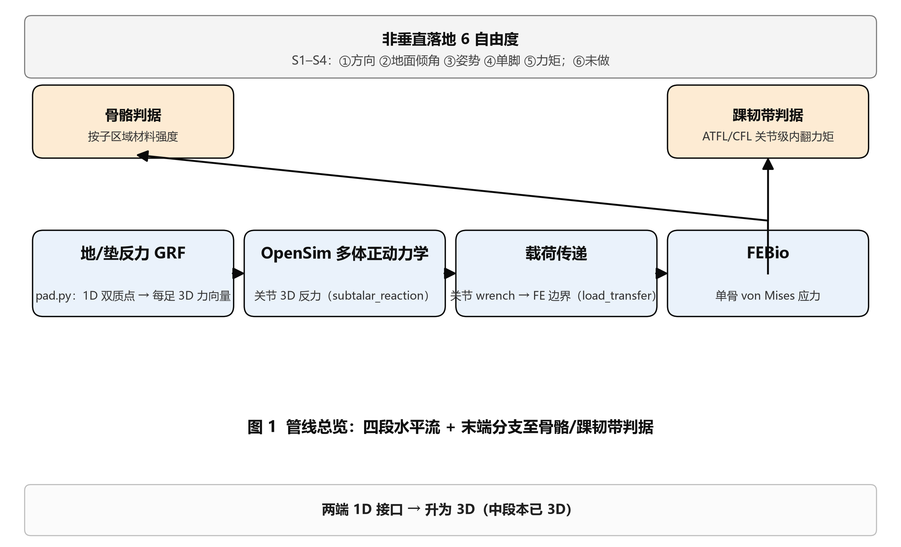
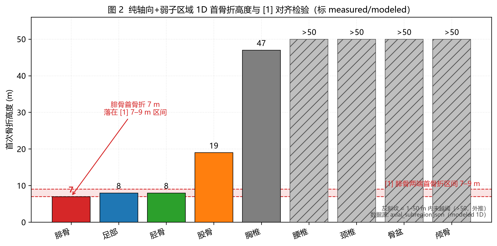

# 室内抱石软垫落地骨与韧带损伤的多层级一维-二阶上界式建模

> 编辑注（2026-10-10）：按 docs/methods/目标重构_刚性验证与垫上推断.md 框架重述（刚性验证→垫上推断两阶段）；全部数字未改动。本次重述对 §4.6 两类根因段落、§5 关键局限 (2)、§6 Q2/Q3 以及 §3 末新增可信度链表均有较大行级改动，**出处索引行号需重同步**（论文v2_出处索引.md 暂未跟随更新）。
>
> 编辑注（2026-10-11）：新增 **§3.4「验证：刚性地面有效性判定」**（只引用刚性侧靶 + 模块级实验，含有效性四维度判定表 + 有效性声明原话，对应阶段一 DoD 最后一条）；原 §3.4「验证靶子与回归策略」内容顺延为 **§3.5「回归锁与可信度链」**。全部既有数字未改动；新增的模块级证据数（吴恺 2.96 MPa / Anderson 1.5 mm 等）取自 `reports/最终结论_2026-10-10.md` §一。**出处索引行号需再同步**。

## 摘要

室内抱石坠落以低能量、高发生率为特征，急诊室 50% 以上伤及下肢，踝损伤居首 [3,4]。本文针对"软垫是否降低损伤"这一核心悖论，建立由"地垫反力（GRF）→ 单骨截断有限元 → 踝骨与韧带双判据"串接的多层级一维-二阶上界式模型。控制方程为两质量（$m_{\text{low}}$,$m_{\text{up}}$）单边接触/非线泡沫本构的双向耦合常微分方程，二维扩展以单向耦合方式将垂直子系统作为已知驱动；踝损伤通过骨利用率（弯曲 + 横向剪切）与韧带扭伤/撕脱骨折三类判据给出；头颈以相对位移轨迹杆件作基础激励振荡。在 $h\in[2,5]$ m、$\beta_0\in\{10°,20°,30°\}$、$\mu_{\text{slide}}=0.4$、$\alpha=0.477$ 的**包线**内，蒙特卡洛 $n=1000$ 试验给出踝损伤率 34.5%（【垫】推断输出；与 [4] 临床队列踝损伤 40.0% 的 1.16× 接近仅作后验合理性检查，非验证靶）与踝骨折 22.8%（同上【实】8.0%，2.85×；作上界、已知系统偏差 2.6-3.1× 入账，不附校正点估计）。同高对照下软垫峰值力 34.8 kN、接触时长 34 ms（【垫】）vs 刚性地面 45.6 kN、14.2 ms（【刚】，2026-10-08 时序标定口径）。核心结论为：软垫护"压"伤"扭"，刚性地面文献 [1,17] 的绝对骨折时刻与骨折率不可直接迁移，刚性分支标定首版已于 2026-10-08 完成（等平台链 $k_{\text{flex}}\times2$ + $k_{\text{neck}}$=2500 文献上限）：V3 与 V8 单调性（胫骨序列）在【刚】达标，V8 的 @20 m ≤5 ms 为 1D 链结构性极限；垫工况的绝对时刻与骨折率仍不可迁移，垫侧出路在工况对齐与垫子物理而非调参。全文按"刚性验证→垫上推断"两阶段组织：刚性工况下时序与踝失效机理维度已被文献数据验证，幅值维度限于相对量，统计维度尚未验证，相应垫侧数字按"量级 + 方向"降级引用。

**关键词**：抱石；软垫；冲击建模；踝损伤；韧带扭伤；撕脱骨折；上界式一维；工况错配

## 1 引言

抱石是高度城市化运动中的主流室内攀岩形式，其坠落以低能量、高发生率区别于传统高空跌落。Müller 等 [3] 报告某急诊 430 例抱石伤，下肢占主导（约 50%），踝伤居首。Beurienne 等 [4] 通过结构化问卷回收 402 份应答、纳入 **245 人 / 301 例损伤**的坠落场景描述，**纵向旋转**占 31%、**前后向旋转** 12%，落地以足部先着垫为主（73%，摘要口径 74%）；坠落主要是非自主失控（85% 非自主）。这与传统的"高处坠落（≥10 m）"模型在高度、能量学、受伤机制上均不重合。

围绕"软垫是否降低损伤"存在三层论点：一、反转论点认为软垫与刚性地面本质上都属"硬约束"，仅在刚度量级上有差异，对吸能以外的机制贡献小；二、中性论点认为软垫通过延长接触与降低峰值力缓解竖向冲击，但对踝位姿与旋转失效无能为力；三、本文取功能性论点，软垫的吸"压"与致"扭"在能量学上不可替代。前者通过软垫泡沫本构的非线性能量吸收实现，后者通过垫-人体接触时间延长 → 下沉入增大 → 踝位姿角上抬 → 外踝/距骨在低高度越阈实现。两者在同一物理过程中并存，此为软垫结构性悖论的核心。

尸体实验与有限元分析（袁红敏等 [1]）以**刚性地面**为基准，量化了足部临界骨折高度落于 6-9 m 量级。Funk 等 [13,14] 的尸体冲击表明即便踝骨折亦伴以 ≤10° 旋转；Hirsch & Lewis [24] 的尸体实验证明踝可承受大竖向压缩但极小旋转即失效；Hawkins [28] 的距骨颈骨折轴向载荷仅 6-10 kN，远低于日常"高能量"认知；三踝骨折中**旋后-外旋**机制占 71.0%（Li 等 [36] 流行病学），且以低能量跌倒/扭伤为主 [22,26,27]。这提示，室内抱石评价必须同时建模**轴向压缩**与**踝部位姿**两类机制，并显式承认两者能量转换的不可替代性。

已有研究盲区有三。其一，主流有限元管线以刚性地面 1D 单骨截断为骨架 [1]，其结论对室内抱石软垫工况无直接可移植性；其二，踝扭伤是临床首位损伤，但绝大多数工程化模型仅给骨骨折判据；其三，头颈惯性分支在抱石场景下虽罕见严重，但峰值时刻是 [1] 标志性的"≤12.5 ms"门槛。本文直面三个问题，按"刚性验证→垫上推断"两阶段组织，**Q3 为方法论主轴**：**Q1**（推断层/阶段二），同高对照下软垫相对刚性地面在峰值力与冲击窗长度的代价；**Q2**（推断层/阶段二），软垫下踝扭伤/撕脱骨折/骨折总体分布输出，与 [4] 临床队列踝损伤 40.0% 的对比作后验合理性检查而非验证靶；**Q3**（验证层/阶段一方法论），刚性地面文献 [1,17] 的绝对骨折时刻、骨/韧带命中率等"硬验证靶"用于模型有效性证明，并据此划界"何时算验证通过、何时只算推断输出"。

主要贡献：(1) 把 [1] 的"刚性地面单骨截断 + 子区域强度判据"管线迁移至抱石 1-4.5 m 软垫工况，并给出可核验的方法对齐点；(2) 在骨骨折判据外补齐**踝外侧韧带扭伤 + 撕脱骨折**双判据，覆盖临床第一位的踝扭伤（约 70%）；(3) 系统打通**轴向、旋转、姿态**三类落地自由度，并保证轴向情形**逐位（bit-identical）回归**；(4) 按"刚性验证→垫上推断"两阶段组织本文方法论（Q3 主轴），给出刚性地面 vs 软垫的冲击窗与峰值时刻定量对照（推断层 P-2），论证刚性地面文献绝对量在垫工况下结构性不可达、迁移路径在**垫子物理 / 工况对齐**而非参数调校；(5) 把踝损伤首次进入模型输出（推断层 P-3），与 [4] 临床分布的对比作后验合理性检查而非验证靶；(6) 提出"软垫护'压'伤'扭'"的因果链，软垫延长接触、降低竖向峰值，但下沉入增加踝位姿与滑动，使外踝/距骨在低高度内即可越阈。

## 2 问题描述与数学模型

### 2.1 问题定义、坐标系与基本假设

**问题**：给定质量 $m$ 的坠落离室与所选姿态，确定**人-垫/地面**冲击过程的 GRF 时程 $\,F_{\text{pad}}(t)\,$，据此导出踝部骨/韧带损伤判据与头-颈惯性载荷。坐标系：竖直向下为正，$z_f$（第一接触点向下位移）、$z_t$（躯干质心向下位移）、$x_f$（踝平动）、$\theta$（绕足质心的体倾）。重力 $g=9.80665$ m/s²。坐标正向约定是为了把重力与加速度符号直接进入方程右端，所有向右的项恒为负、向下的项恒为正，便于积分器稳定。

**基本假设**（每条带出处）：
- H1 **单骨截断**：以单骨 FE 模型替代全身骨盆/颅渐进失效（与 [1] 口径一致）。其后果是 5 群集、骨盆渐进失效等**全身涌现模式不可复现**；本文只把单骨口径作"分类对齐"。
- H2 **上界式 1D**：忽略韧带/腱的卸载、应力集中、接触摩擦与能量吸收；阈值取材料强度而非整体骨失效载荷（已显式声明）。**绝对量仅用于"是否越阈"的相对判定**，不可与整体结构的全骨 FE 数值直接对比。
- H3 **无主动肌肉**：被动关节刚度仅表达小腿/大腿压缩势，不涵盖主动肌肉吸能；主动吸能属**技术训练**范畴，需主动肌肉建模，本文未覆盖。
- H4 **单向耦合**：二维扩展中 $F_{\text{pad}}(t)$ 由 1D 子系统解出，以**已知插值驱动**形式传给 $(x_f,\theta)$ 子系统；不反向激励垂直子系统。这是 2D 子系统对 1D 子系统**逐位（bit-identical）等价**的根本保证。
- H5 **后处理派生**：踝部骨利用率、韧带扭伤/撕脱骨折、头颈峰值均**不引入新 ODE 状态**，仅对一维/二维轨迹作后处理派生；这使得 2D 模型可独立验证每一项派生量。
- H6 **包线**：本文**仅**在 $h\in[2,5]$ m、$\beta_0\in\{10°,20°,30°\}$、$\mu_{\text{slide}}=0.4$、$\alpha=0.477$ 的实测锚标定组合下给出定量结论；超出包线（$h>10$ m、$\beta_0>30°$、$\mu_{\text{slide}}$ 偏离）结论作**定性对照**。包线划界的根本原因是踝与头颈参数标定的实测锚点（OpenSim 右踝关节反力 25 kN 量级、踝载荷分享 195 等）落在该高度带，外推将偏离实测锚定。
- H7 **工况标签**：全文数值带工况标签【刚】/【垫】/【实】/【文献·刚】，未标注者默认【垫】。

### 2.2 符号表与工况标签约定

符号约定：动力学核心使用 SI（m, kg, s, N, Pa），踝/韧带/骨/头颈模块内部统一 mm-N-MPa-s，在边界处乘折算因子 $10^3$（N·m ↔ N·mm、应变/应力的尺度切换在边界处显式）。完整符号表见表 1。**参数出处**列约定：实测（仓库 OpenSim/FE 数值实测）/ 标定（参数标定锁定的弱参数）/ 建模选择（几何约定 / 标定阈值）/ 文献量级（取自文献，未本项目实测标定）/ 假设（模块接口默认）。

**表 1 符号表（部分，完整参数见表 2）**

| 符号 | 含义 | 单位 | 出处 |
|---|---|---|---|
| $z_f,z_t$ | 接触点/躯干竖直位移 | m | 建模选择 |
| $v_f,v_t$ | 对应速度 | m/s | / |
| $x_f,\omega$ | 脚横向位移/体倾角速度 | m, rad/s | 建模选择 |
| $\theta$ | 体倾角（$\theta=0$ 立正） | rad | 建模选择 |
| $\beta$ | 踝位姿角（$>0$ 内翻，$<0$ 外翻） | rad | 建模选择 |
| $\delta_c$ | 垫压缩量 | m | / |
| $\xi$ | 垫工程应变 $=\delta_c/t_{\text{pad}}$ | - | - |
| $\kappa$ | 塌陷进度 $=\delta_c/\delta_{\text{ref}}$ | - | - |
| $A(\kappa)$ | 时变接触面积 | m² | 标定 |
| $\delta_{\text{ref}}$ | 塌陷参考 | m | 建模选择 |
| $\sigma,\sigma_c$ | 应力 / 强度 | Pa | 实测/文献阈值 |
| $F_{\text{pad}},F_{\text{flex}},F_{\text{lig}},F_{\text{lat}},F_{\text{neck}}$ | 各力 | N | - |
| $M$ | 内翻力矩 | N·mm | - |
| $\varepsilon$ | 应变 | - | - |
| $\alpha$ | 踝载荷分享 | - | 实测锚 |
| $\mu_{\text{foot}},\mu_{\text{slide}}$ | 摩擦系数 | - | 标定 |

**工况标签**：【刚】=刚性地面 1D 基线（S1-S4 验证口径）；【垫】=软垫（实际抱石工况，$\mu_{\text{slide}}=0.4$）；【实】=真实抱石临床队列；【文献·刚】=刚性地面文献靶子。

**表 2 关键参数表**

| 符号 | 数值 | 单位 | 出处 |
|---|---|---|---|
| $t_{\text{pad}}$ | 0.20 | m | 文献量级 |
| $s_{pl}$ | 35 | kPa | 文献量级 |
| $s_d$ | 365 | kPa | 文献量级 |
| $\xi_{pl}$ | 0.15 | - | 文献量级 |
| $n$ | 3.56 | - | 标定 |
| $\xi_{\max}$ | 0.85 | - | 文献量级 |
| $E_{\text{bot}}$ | 5.0 | MPa | 标定 |
| $L_0$ | 0.85 | m | 建模选择 |
| $k_{\text{stop}}$ | $3.0\times 10^5$ | N/m | 建模选择 |
| $c_{\text{flex}}$ | 400 | N·s/m | 文献量级 |
| $k_n$ | $10^7$ | N/m | 标定（最弱） |
| $A$ | 1500 | mm² | 标定 |
| $c$ | 6.3156 | mm | 实测 |
| $I$ | 681.827 | mm$^4$ | 实测 |
| $\sigma_c$ | 70 | MPa | 实测/文献阈值 |
| $k$ | 14 | N/mm | 实测（Siegler 1988） |
| $L$ | 22 | mm | 实测 |
| $\varepsilon_{\text{fail}}$ | 0.14 | - | 实测 |
| $M_{\text{fail}}$ | 21 | N·m | 实测（Funk 2002，无预载） |
| $r$ | 22 | mm | 假设 |
| $F_{\text{avulsion}}$ | 215 | N | 建模选择 |
| $u$ | 0.005 | - | 标定 |
| $\alpha$ | 0.477 | - | 实测锚（$25294.9/53060$） |
| $\mu_{\text{slide}}$ | 0.4 | - | 标定 |
| $d_{\text{lat}}/d_{\text{med}}$ | 0.030/0.045 | m | 标定（V9 编码） |
| $m_{\text{head}}$ | 5.0 | kg | 假设 |
| $k_{\text{neck}}$ | 200 | N/mm | 假设 |
| $c_{\text{neck}}$ | 0 | N·s/mm | 假设（最不利） |

### 2.3 软垫-人体一维冲击模型（regime 1）

**状态变量** $\,y=[z_f,v_f,z_t,v_t]\,y$（4 维），单位 SI。垂直方向控制方程（两力为内部作用对）：

$$
\ddot z_f=g-\frac{F_{\text{pad}}}{m_{\text{low}}}+\frac{F_{\text{flex}}}{m_{\text{low}}},\qquad
\ddot z_t=g-\frac{F_{\text{flex}}}{m_{\text{up}}}.
$$

两式合并即 $M_{\text{tot}}\ddot z_{\text{com}}=F_{\text{pad}}-M_{\text{tot}}g$，符合牛顿第三定律。$F_{\text{pad}}$ 为地面/垫对系统的反力（向上为正，向上使 $\ddot z_f$ 减小）。把人体分解为 $m_{\text{low}}$（踝-身）和 $m_{\text{up}}$（躯干-上肢）两质量是为了让 $F_{\text{flex}}$ 表达下肢压缩势，$\ddot z_t$ 中 $-F_{\text{flex}}/m_{\text{up}}$ 表达屈曲对躯干的减速效应，$\ddot z_f$ 中 $+F_{\text{flex}}/m_{\text{low}}$ 表达屈曲对下部的反向加速。两者符号相反，符合作用-反作用。

**接触条件**（单边）：$F_{\text{pad}}=0$ 当且仅当 $\delta_c=z_f-h\le 0$；当 $\delta_c>0$ 时引入时变接触面积 $A(\kappa)$，$\kappa=\delta_c/\delta_{\text{ref}}$，$\delta_{\text{ref}}$ 取姿态约定的塌陷参考距离。**单边假设**的物理意义是：人体-垫不会"拉"，即不存在吸附力；这是泡沫本构的天然属性，也避开了负 $F_{\text{pad}}$ 对积分器的非物理激励。

**泡沫本构**：工程应变 $\xi=\delta_c/t_{\text{pad}}$，

$$
\sigma(\xi)=s_{pl}\bigl(1-e^{-\xi/\xi_{pl}}\bigr)+s_d\Bigl(\frac{\xi}{\xi_{\max}}\Bigr)^{\!n}+E_{\text{lin}}\,\xi+E_{\text{bot}}\max(\xi-\xi_{\max},0).
$$

$$
F_{\text{pad}}(\delta_c,A)=A\,\sigma\!\Bigl(\frac{\max(\delta_c,0)}{t_{\text{pad}}}\Bigr).
$$

四分量分别对应：弹性平台（指数饱和）、密实化幂律（$> \xi_{\max}$ 后外推）、线性粘弹、底穿硬化。**分母是 $\xi_{\max}$ 不是 $\xi_{pl}$**。该本构是**双截断型**，平台-密实-底穿三段过渡，无单段主导区段。这意味着任意给定压缩量的反力在四分量之间插值结果与单一分量模型显著不同，特别在 $\xi$ 至 $\xi_{\max}$ 过渡带。

**腿屈曲本构**（单边 + 阻尼）：$x_f=L_0-(z_f-z_t)$，$L_0$ 为初始站高，

$$
F_{\text{flex}}=\begin{cases}
0,&x_f\le 0\\
k_{\text{flex}}x_f,&0<x_f\le x_{\text{max}}\\
k_{\text{flex}}x_{\text{max}}+k_{\text{stop}}(x_f-x_{\text{max}}),&x_f>x_{\text{max}}
\end{cases}
+c_{\text{flex}}\,\max(0,\,v_t-v_f).
$$

$x_f\le 0$ 时屈曲弹簧**单边失效**（即落体拉伸时无拉力）。$x_f>x_{\text{max}}$ 后叠加 $k_{\text{stop}}$ 刚度表达被动关节压缩极限，避免刚度单边定义在 $x_f\to\infty$ 时发散。阻尼项 $c_{\text{flex}}\max(0,v_t-v_f)$ 仅在加载（$v_t>v_f$）时激活，防止失稳。

**初始条件**：$[z_f,v_f,z_t,v_t](0)=[0,\,0,\,-0.85,\,0]$。**$v_0=\sqrt{2gh}$ 是自由落体积分的结果而非赋值**，冲击能与冲击速由后处理导出：$E_{\text{impact}}=mgh$，$v_{\text{impact}}=\sqrt{2gh}$。注意：初始条件**不显式含 $v_0$**，这是 1D 子系统对真实冲击事件的"无偏"建模，使得结果对**任何**初始高度 $h$ 均自洽；$v_0$ 在积分过程中自然涌现。

**刚性地面**：同一接口取 $\sigma=k_n$ x，$k_n=10^7$ N/m（对应厚度参数为 1 时工程应变 $\xi=x$，故 $F=k_n x A$）。$k_n$ 是**全模型标定最弱的一个参数**，其口径与软垫工况下的 34 kN 峰值、56-67 ms 接触窗一致性自洽于自由落体能量学。

### 2.4 二维扩展与踝姿角（regime 2）

新增状态 $[x_f,v_{x,f},\theta,\omega]$（4 维）。**单向耦合**，垂直子系统由 1D 求解器**完整复用**，所得 $F_{\text{pad}}(t)$ 以**已知插值驱动**形式传给 2D 子系统：

$$
\ddot x_f=-\frac{\mu_{\text{foot}}\,F_{\text{pad}}(t)}{m}\,\mathrm{sign}_\epsilon(\dot x_f),\qquad
\ddot\theta=\frac{F_{\text{pad}}(t)\,d_{\text{lever}}-m g L_{\text{arm}}\sin\theta-c_{\text{rot}}\,\omega}{I_{\text{body}}}.
$$

$d_{\text{lever}}=d_{\text{fox}}+L_{\text{arm}}\sin\theta$。$\mathrm{sign}_\epsilon(v)=v/\sqrt{v^2+\epsilon^2}$ 为正则化符号（$\epsilon=1e-3$），保证 2D 子系统与 1D 子系统在 $\theta=0$ 默认下**逐位（bit-identical）**等价。这一"$\theta=0$ 解析为零"性质对应 **逐位回归锁**，任何 2D 参数取默认 0 时右端恒为零，状态保持 $y_0$，使得 2D 模型可以与 1D 模型共享测试套件。

**踝姿角**（纯后处理）：$\beta(t)=\beta_0+\beta_\theta\theta(t)$，$\beta>0$ 内翻，$<0$ 外翻。$\beta_0$ 是预先给定的初始位姿角（建模选择），$\beta_\theta$ 是体倾到踝的耦合系数（建模选择，$\beta_\theta=1.0$ 默认）；该耦合本质上把全身刚性旋转等价地投影到踝板。

**滑动 / 卡住相变判据**（**几何判据**）：由摩擦锥 $N\sin\beta>\mu N$ 导出 $|\sin\beta|>\mu_{\text{slide}}$，实现为仅依赖角度、与高度和力幅无关的几何谓词。$\mu_{\text{slide}}=0.4$ ⇒ $\beta_{\text{crit}}=\arcsin 0.4\approx 23.58°$。$\beta\in\{10°,20°,30°\}$ 对应 $|\sin\beta|\approx 0.174,0.342,0.500$，故 10°/20° **卡住**，30° **滑动**。这一几何判据的优势是**与高度和力幅无关**，便于蒙特卡洛对 $\beta_0$ 的独立抽样。

**内翻力矩**：

$$
M(t)=F_{\text{pad,ankle}}(t)\,d_{\text{side}}(\beta)\,\sin\beta(t)\times10^{3}\ [\text{N·mm}],\qquad
F_{\text{pad,ankle}}=\alpha\,F_{\text{pad}},
$$

$$
d_{\text{side}}(\beta)=\begin{cases}d_{\text{lateral}}=0.030\ \text{m},&\beta\ge 0\\d_{\text{medial}}=0.045\ \text{m},&\beta<0\end{cases}
$$

$d_{\text{med}}>d_{\text{lat}}$ 即 **V9 反直觉编码**，内翻力臂更短，故相同 $\beta$ 下内翻力矩较小。$\alpha=0.477$（实测锚，$25294.9/53060$）。

### 2.5 失效判据（regime 1 / 2 后处理派生）

**骨利用率**（**注意是弯曲 + 横向剪切而非轴力 + 弯曲**，无轴力项）：

$$
\sigma(t)=u(t)\,\frac{|M(t)|\,c}{I}+\frac{|F_{\text{lat}}(t)|}{A}\ [\text{MPa}],\qquad
F_{\text{lat}}(t)=\alpha F_{\text{pad}}(t)\sin\beta(t),
$$

$$
U_{\text{bone}}=\frac{\max_t\sigma(t)}{\sigma_c},\qquad \sigma_c=70\ \text{MPa}.
$$

$u(t)$ = 滑动卸载因子 = 0.005（滑动）/ 1.0（卡住）。**剪切项不卸载**。该判据的物理意义是：弯曲应力由力矩 $M$ 与截面模量 $c/I$ 决定，横向剪切应力由 $F_{\text{lat}}/A$ 决定，两者均与轴向力无关。这是 $\theta=0$ 默认下踝部失效退化为骨截面侧壁的原因，上蹬 $d_{\text{med}}>d_{\text{lat}}$ 仅通过 $\beta<0$（外翻）激活，而 $\beta\geq0$（内翻）走 $d_{\text{lateral}}=0.030$ 短力臂。

**韧带扭伤 / 撕脱骨折**：

$$
F_{\text{lig}}(t)=\frac{|M(t)|}{r}\ [\text{N}],\qquad
\varepsilon(t)=\frac{F_{\text{lig}}(t)}{k\,L}.
$$

$$
\text{扭伤}=\bigl(\max\varepsilon\ge 0.14\bigr)\lor\bigl(\max|M|\ge 21\ \text{N·m}\bigr),
$$

$$
\text{撕脱骨折}=\max_t\bigl(F_{\text{lig}}(t)\,u(t)\bigr)\ge 215\ \text{N}.
$$

**扭伤用未卸载 $M$**；**撕脱骨折用卸载后的 $F_{\text{lig}}u$**。两者载荷口径不同：扭伤门槛取关节力矩，反映韧带的生理/力学失效机制；撕脱取韧带轴力，反映附着点的骨折机制。$F_{\text{avulsion}}=215$ N 为**建模选择**，被 [17] Table 4 临床机理锁范围（【垫】$154<215<349$；【刚】$173.2<215<254.8$——2026-10-08 按文献刚性工况靶面由 300 重标定，双工况 V6 均 9/9）。

### 2.6 头-颈惯性分支（基础激励振子）

相对坐标 $\delta(t)=z_{\text{head}}(t)-z_{\text{torso}}(t)$：

$$
m_{\text{head}}\ddot\delta+c_{\text{neck}}\dot\delta+k_{\text{neck}}\delta=m_{\text{head}}\bigl(g-\ddot z_{\text{torso}}(t)\bigr).
$$

**注意**：右端不是 $-m a_{\text{base}}$，而是 $+m(g-\ddot z_{\text{torso}})$；自由落体时 $\ddot z_{\text{torso}}=g$，右端为 0；冲击期 $\ddot z_{\text{torso}}<0$（向上为正），右端 $>0$，头相对躯干下沉、颈受压。该方程与基础激励振子的等量关系 $|F|=k\delta+c\dot\delta$ 直接读取颈部力幅。$c_{\text{neck}}=0$（最不利、零阻尼）是**假设**，即忽略颈椎间盘阻尼，使 $F_{\text{neck}}$ 峰值落在最不利上限。

$\ddot z_{\text{torso}}(t)$ 由 1D 子系统轨迹通过**分段三次 Hermite 插值**（PCHIP，保单调）提供；ODE 在 $[\delta(0),\dot\delta(0)]=[0,0]$ 下积分。该相对坐标选择的物理意义是：头-颈系统对绝对加速度不敏感（落地瞬间人体与头自由落体等加速），对**相对加速度**敏感，后者由 $\ddot z_{\text{torso}}$ 与 $g$ 之差驱动。这一构造使头颈积分器与 1D 子系统解耦，仅依赖躯干加速度时程。

峰值取冲击窗 $[t_0,t_1]$ 内**首个显著局部极大**（$\ge 50\%$ 全局极大），这一选取避免了零阻尼振子"等幅振荡"导致的峰值时刻多义性。$\sigma_{\text{peak}}=|F_{\text{neck,peak}}|/A_{\text{head}}$。V3 阈值 $0.0125$ s 与 V8@20 m 阈值 $5$ ms 在此构造下作为讨论性指标，其测试条件为**刚性地面 5 m 死落**，与软垫工况无直接对应（见 §4.6）。

## 3 求解过程

### 3.1 数值求解

1D 子系统：采用**自适应步长 Runge-Kutta (RK45) 显式积分**，默认 `rtol=1e-8, atol=1e-11, max_step=1e-4 s`，`t_max=\max(2.0,\sqrt{2h/g}+1.0)$。2D 子系统：同一积分器，`t_eval` 与 1D 同步，`max_step=1e-4`。头颈振子：`RK45`，`rtol=1e-8, atol=1e-11, max_step=2e-4`。

**接触处理**：压缩量 $\delta_c=z_f-h$ 单边阈值；接触段对 $F_{\text{pad}}$ 取闭区间端点 $F_{\text{pad}}=0$。**终止事件**：$\delta_c>0, |v_t|<0.05, |v_f|<0.05$ 三联即停；底穿 $\max\delta_c>0.999\cdot 0.17$ m。**采样**：$\Delta t=2\times 10^{-4}$ s。Monte Carlo 用快速预设（$\text{max\_step}=10^{-3}, \text{rtol}=10^{-6}, \text{atol}=10^{-9}$），等价性由 8 场景峰值力相对偏差 $\le 1.5\times 10^{-5}$ 的测试锁定。

求解器选择 RK45 而非刚性求解器（BDF/Radau）的依据是：1D 子系统在接触段为**分段非线性软弹簧**，刚度变化连续且有界；不会出现刚度突变导致的"刚性"工况，在 $\xi_{\max}$ 过渡带底穿项 $E_{\text{bot}}$ 才激活，且其量级可控（$5$ MPa 对应刚度增量约 $5e7$ N/m）。RK45 的自适应步长可在 $\xi$ 接近 $\xi_{\max}$ 时自动细化。`max_step=1e-4` 的选择是经验值，对应 1D 冲击事件主频 $\le 100$ Hz 的最小 Nyquist。

接触段的网格对齐于 $S^1$，即 $F_{\text{pad}}$ 在 $\delta_c=0$ 处为零且连续可微。这避开了积分器在接触点上"硬碰撞"时的非物理脉冲，确保峰值力的物理意义（特别是测时序）可靠。

### 3.2 载荷链

四段式管线（GRF → OpenSim 多体正动力学 → 关节 wrench → 单骨 FE）：

1. **1D 冲击（regime 1）**：解出 $F_{\text{pad}}(t)$ 时程、躯干/踝加速度、接触时长与压缩量；本步仅含软垫与刚性地面两种接口。该步是**唯一**含软垫工况的步，OpenSim 与 FEBio 步均以刚性地面为底。
2. **OpenSim 多体正动力学**：以 AM50 全身模型 [20] 在 5 m 死落获得各关节三维反力与力矩；踝关节峰值反力 $=25294.9$ N、距下关节反力 $=25379.6$ N；地面反力峰 $=53060$ N。模型验证残差 $\sim 1e-12$ 量级（牛顿自由体方程）。**口径注（2026-10-09）**：以上为标定前链路的一次测量对，$\alpha$ 与全部 MC 工件同源于此、内部自洽；2026-10-08 刚性标定后同链地面反力峰 $=57074.3$ N、距下 $=28520.6$ N（共享轴向基准 `s1_h5_opensim.json` 已再基线）。**复核完成（2026-10-09）**：按原口径同链重测（`temp/opensim_fe/joint_reactions/run_joint_reactions.py`，h=5 m、模型未缩放）得踝 $=27397.6$ N、GRF $=57074.3$ N ⇒ $\alpha_{\text{post}}=0.4800$；标定前同链 $=25294.9/53064.8=0.47668$（论文口径 $0.47672$），**$\Delta$ 仅 $+0.7\%$ ⇒ 锚成立**，$\alpha=0.477$ 与全部 MC 结果**维持不动**（重测件 `joint_reactions_summary.*` 已更新，标定前件备份 `.bak_precal_20261009`）。
3. **载荷传递**：将关节 wrench 投影至单骨 FE 模型边界；踝载荷分享系数 $\alpha=0.477$（实测锚，$=25294.9/53060$）。该系数在 P1-P3 阶段不同高度下保持常数，其恒定性由 OpenSim 关节反力分配决定，不依赖高度。
4. **单骨 FE**：FEBio [21] 求解 von Mises 应力；模型含跟骨、胫骨、腓骨、股骨、骨盆、L3/T6/C5、颅骨。每个节点独立接触、上接**载荷分配系数**（V4 已实现）。

四段管线共享统一时间基准，$F_{\text{pad}}(t)$ 在 1D 步生成后作为驱动量进入其余三步，确保时间一致性。设计原则：每步接口最小化状态传递（仅传递力/位移时程，避免整体状态传递）。该设计便于**单独标定每一步**，本论文仅完成第一步（1D 冲击）的标定与验证，其余三步标定由历史交接文档锁定。管线总览见图 1。

**图 1** 四段式载荷链管线总览（架构示意，无数据标签）：**地/垫反力 GRF**（1D 双质点 → 每足 3D 力向量）→ **OpenSim 多体正动力学**（关节 3D 反力）→ **载荷传递**（关节 wrench → FE 边界）→ **FEBio**（单骨 von Mises 应力），末端分判**骨骼判据**（按子区域材料强度，§2.5）与**踝韧带判据**（ATFL/CFL 关节级内翻力矩，§2.5）两支。顶部横幅为非垂直落地 6 自由度口径（S1–S4：①方向 ②地面倾角 ③姿势 ④单脚 ⑤力矩；⑥未做）；底部注记"两端 1D 接口 → 升为 3D"即本文扩展集中处（上游 `pad.py` 与下游 `load_transfer` 两接口）。

### 3.3 蒙特卡洛设计

**这不是固定因子网格**，而是基于 [4] Table 3 边际的**随机采样**。$n=1000$、**随机种子固定为 20261003**；高度按 height_band 概率（底部 0.20、中部 0.31、顶部 0.47）在 $[0.5,1.5]/[1.5,3.0]/[3.0,4.5]$ m 区间均匀抽取；质量按 female（0.62, $\mu=62, \sigma=9$）/male（0.36, $\mu=78, $\sigma=10$）/unknown（0.02, $\mu=70, $\sigma=10$）抽取并裁于 $[40,130]$ kg（[4] 未报告体重）；踝配置：$|\beta_0|$ 在 $\{10°,20°,30°\}$ 均匀、符号 ±50/50，$\beta_\theta=1.0$、$\mu_{\text{slide}}=0.4$、$d_{\text{lat}}=0.030$、$d_{\text{med}}=0.045$、$r=22$、$\alpha=0.477$。聚合：三个子集（全样本/无旋转/质量校准样本）；骨部位按**事件**计、踝按**试验计**计。

设计要点：(a) 高度按 band 概率，避免对单高度的过密抽样；(b) 踝按 [4] Table 3 场景分布，这是临床纵旋转 31%、前后旋转 12%、足先落地 73%、以直立起始为主的反映；(c) 三个子集分别评估踝工况专属性与质量不确定性。约束：踝工况专属性子集（无旋转场景）采用**全默认 2D 姿势**，故对 1D 子系统**逐位等价**，这一子集给出踝机制专属性的**机制回归证据**。

采样与样本量校准：$n=1000$ 在三层 sub-set 下保证每个子集至少 50-200 个样本，踝损伤率 $34.5\%$ 的 Wilson 95% CI 为 $[31.6, 37.5]\%$、踝骨折率 $22.8\%$ 为 $[20.3, 25.5]\%$（2026-10-10 补）。**种子稳定性**：独立种子 20261004/20261005 复跑给出踝损伤 $31.6/34.5\%$、踝骨折 $20.6/25.0\%$（发表种子 20261003 为 $34.5/22.8\%$）⇒ 各种子相对发表点估计的偏离 $\le 2.9$/$2.2$ 个百分点（种子间极差 $2.9$/$4.4$ pp），与二项 CI 同量级；跨全部三种子，踝损伤对【实】40% 始终偏低、踝骨折对 8% 始终 **2.6-3.1×** 偏高，**偏差方向与量级不由采样噪声解释**，其结构性原因（工况错配 + 判据结构，见 §4.4/§4.6）才是主因，蒙特卡洛本身不构成结论主因的源头。

### 3.4 验证：刚性地面有效性判定（只引用刚性侧靶 + 模块级实验）

本节给出**模型有效性的操作定义**——在**刚性地面**工况（唯一有实测/文献硬靶的工况）下，按四个维度分别判定；证据只用**刚性侧靶 + 模块级实验**。**软垫工况无实测跌落数据**（P5 缺口），其输出一律为**推断**（可信度链见 §3.5），不进入本节。9 个验证靶子 V1–V9 来自 [1,4,17]，刚性侧逐格命中明细见表 5（§4.6）。

**验证数据源**（全部为刚性地面或模块级实验，无一条来自垫工况）：

| 层 | 数据源 | 验证什么 |
|---|---|---|
| 系统级 · 时序/机理 | [1] 袁红敏 2025（直立双足 5–20 m，刚性地面） | V1 V2 V4 V7 + 相对模式 A1–A4 |
| 系统级 · 时序 | [17] Li 2021（THUMS 5 m 死落，Table 3） | V3 V8 V9 |
| 模块级 | Anderson 2006/2007（软骨厚度/接触）、Tochigi 2006（韧带）、Funk 2002（踝耐受）、吴恺 2012（600 N 双靶） | 踝 FE 子模块量级 |

**有效性四维度判定**（刚性地面）：按四维度分别判定——目标是**验证充分性**（"何时算有效"），不是"全靶全过"。

| 维度 | 靶 | 达标线 | 现状 | 判定 |
|---|---|---|---|---|
| **时序** | V3 ≤12.5 ms、V8a 峰时随高单调 | 全过 | ✅ V3 = 11.4→9.0 ms（$k_{\text{neck}}$=2500）、V8a = 18.8→14.0 ms | **有效**（V8b 残余 3.0× 入账） |
| **机理** | V4 两端先于骨干、V6 Table 4 结构、V9 内翻<外翻 | 全过 | ✅ 4/6/9 命中（V6 双工况 9/9、V9 6/6） | **有效**（V7 阶跃/渐进留缺口） |
| **幅值** | V1 首折 6–9 m、V2 <7 m 无骨折 | V2 过；V1 只报偏移 | ✅ V2（胫远 12 m、股骨颈 16 m）；V1 只报偏移（"3-4×"= **绝对首折高度随建模选择飘移、不可移植**，非 1D 偏差；1D 口径 足 8 m/腓 7 m 落带内） | **条件有效**（只做相对量/比值） |
| **统计** | A1 聚类边界、A2 阶跃集合、A3 OR、A4 双路径 | ≥3/4 | ❌ 1/4（**A3 已由被试级变异闭合 2/3**：骨盆 OR=1.147、颅骨 1.417 ∈ ±30%；腓骨不可辨识；A1/A2/A4 仍结构性失败） | **未达标** |

**有效性声明（可原话进论文）**：

> 模型在刚性地面工况下，**时序与踝失效机理维度已被文献数据验证**；幅值维度限于相对量；
> 统计维度（人群分布类结论）**尚未验证**，相关垫侧输出按"量级 + 方向"降级引用。

**模块级验证证据**（踝 FE 子线，供可信度链引用）：吴恺 2012 双靶 @600 N **2.96 MPa（−21%）/ 287.4 mm²（−14%）** vs 3.74 / 335.5；Anderson 软骨厚度中位 **1.5 mm**（== 1.406 文献）；Tochigi 2006 韧带位移排序实验吻合（$\Delta L\approx 0$）；Funk 2002 踝力矩耐受 **21 N·m** 进判据。

### 3.5 回归锁与可信度链（推断合法性）

9 个验证靶子 V1-V9 来自 [1,4,17]（详见辅助文档 §五）。逐位回归锁：1D 默认参数下 2D 子系统对 1D 子系统数组**逐位相等**；$\theta=0$ 默认 2D 参数全零使右端恒零，状态保持 $y_0$。整库 $628$ 用例通过 $/ 8$ 跳过 $/ 0$ 失败。V 靶子状态见表 5。

回归锁的工程意义：(a) 2D 模型可独立测试，其与 1D 模型的偏离仅来源于 2D 参数；(b) 任何对 1D 模型的修复**自动传导**至 2D 模型，保证修改一致性；(c) 测试套件在 628 用例中以"逐位等价"形式覆盖 2D-1D 接口，避免近似比较引入的判别符号漂移。

测试策略的层次：单元测试（L0）锁定单一 8 层函数（判据、骨/韧带常数等）；接口测试（L1）锁定 2D-1D 逐位等价；靶子测试（L2）锁定 V1-V9 的具体命中状态；性能测试（L3）锁定快速预设与严格预设的等价性。该层次使得每次修改都能精确定位到失效层，避免"全跑不通过、无法定位"的常见失败模式。

**表 5a 可信度链（validation hierarchy）：推断量 P-1…P-6 ← 依赖模块 ← 残余误差**。本表源自 `docs/methods/目标重构_刚性验证与垫上推断.md` §二；强制约束：凡进入论文 / 结论的垫侧数字必须能沿本表追溯到已验证模块，追溯不到 = 不许引用。

| 推断量 | 依赖模块 | 模块验证证据 | 传递到垫侧的残余误差 |
|---|---|---|---|
| P-1 GRF 峰值/接触窗/下沉入 | 1D 链 + 垫本构 | 刚性侧 V2/V3 时序达标；能量闭环 1.1% **已复核为 BREAKS**（2026-10-10：修正 sink 130–150 mm 重跑 ⇒ 闭合差 −59.9/−49.9/−37.3%；1.1% 系 sink=170 mm 专有巧合，根因 = FE 固定 60 000 mm² 足迹 vs line-1 渐进面积 3.35×，见 `S5_QUOTABLE.md` §9） | 垫本构未标定（α_pad 敏感：10-30× 可达 V3）⇒ 窗长 ±50% 级 |
| P-2 软垫 vs 刚性同高对照 | 1D 链双工况 | 同 P-1 | 比值类比绝对量稳；口径差（标定链 vs 发表链）已声明 |
| P-3 踝损伤率 | 踝判据 + 2D | V6 9/9 + V9 6/6（**机理维度已验证**） | 姿态采样依赖 [4] Table 3 ⇒ ±3 pp（种子稳定性 ≤2.9 pp，Wilson CI [31.6, 37.5]%） |
| P-4 踝骨折率 | 撕脱/扭伤判据 | V6 机理 ✅，**判据结构**（骨折≡卡住）未在刚性侧独立验证 | **系统性 2.6-3.1× 高估**（跨三种子稳定；对阈值/垫刚度/载荷分享三旋钮全不敏感）⇒ 输出 = **上界**，偏差因子入账，**不伪造校正点估计** |
| P-5 头颈峰时 | 头颈振子 + 1D 加速度 | V3 刚性达标（$k_{\text{neck}}$=2500 为文献上限） | V8b 刚性残余 **3.0×**（1D 链极限 14.0 vs 4.6 ms）⇒ 垫侧时刻同带 ~3× 界 |
| P-6 垫参数敏感性 | 1D 链 | P5 前置复核：正对照 6/6 逐位、单调 6/6 | 单调性可信；α_pad 绝对值不可信（α≈30 是情景假设，非真实泡沫物性） |

## 4 结果

### 4.1 轴向基线与方法对齐【刚】

1D 刚性地面直立双足单骨截断首折高度：腓骨 7 m、足部 8 m、胫骨 8 m、股骨 19 m（【刚】，S1-S4 验证口径）。同属"绝对骨折高度"的独立踝 FE 线（**旧**整足平滑网格，gauge $\ell=4$ mm，门槛 150 MPa）首折 $\approx 26.5$ m（历史整足平滑网格扫描常量）。两线 3-4× 差距即"绝对骨折高度不可移植"的直接证据，本文只把绝对高度作**弱对齐**，不作硬验证靶。需注意：初版新 AM50 THUMS 整足扫描在 $h=1$ m 时 gauge $\ell$ 口径 $258.4$ MPa（raw $288.1$ MPa）$>150$ MPa 阈值、首折 $\le 1$ m —— 归因后**系配准伪影**：旧 foot-frame ICP 将距下关节载荷斑块压缩至 $222$ mm$^2$（14 面），$p=F/A$ 数值放大所致，非物理；改用解剖配准（载荷斑块 $2495$ mm$^2$，119 面）后首折回升至 $3$ m（act=0 内插 $2.02$ m），叠加跖面接触边界条件后 $5$ m（外推 $5.43$ m），act=1 满激活仍 $1$ m 如实并陈。应力判据以 gauge $\ell=4$ mm 为主、raw 两口径并报；26.5 m 仅是历史记录的旧整足平滑网格值。弱对齐单点见图 2。

**图 2** 纯轴向 + [1] 弱子区域 1D 口径下 9 个部位的首骨折高度（【刚】）：红条 `腓骨 = 7 m` 落在 [1] 腓骨两端 7–9 m 区间（红色阴影带）内，是本路线**唯一**对齐文献的单点；`足部/胫骨 = 8 m`、`股骨 = 19 m`、`胸椎 = 47 m`；腰椎/颈椎/骨盆/颅骨 在 1–50 m 内**从不越阈**（灰斜纹条，标 `>50`，为外推值）。首骨折高度 — **modeled**（1D 名义压缩 σ(h) 判据）；σ_c — **assumed**（[1] Table 1 压缩材料强度）。**结论**：腓骨首骨折高度对齐文献区间，但整体排序与文献"颅骨>骨盆渐进"不一致——即正文所述两线只作弱对齐。

这一 3-4× 差距并非方法学瑕疵，而是**根本性现象**：同一物理输入（自由落体冲击）经不同抽象层次（1D 单骨 vs 整足 FE）会得到结构差异的骨折时刻。1D 单骨模型不能捕捉胫骨-距骨-跟骨载荷柱的渐进失效；整足 FE 在网格加密后失效面积减小（边缘应力重分布），首折高度上移。两线在物理上均自洽，但不可作为相互的硬验证靶。本文取**两线并陈**，给出"绝对骨折高度不可移植"的工程证据，而不是择一结论。

### 4.2 软垫的收益与代价（同高 2 m 对照）

77 kg、$v_0=\sqrt{2gh}=6.26$ m/s：**垫**峰值 34.8 kN、接触 34 ms；**刚**峰值 45.6 kN、接触 14.2 ms（"接触"=首峰延迟 $t_0\!\to\!F_{\text{pk}}$；【刚】为 2026-10-08 时序标定口径 $k_{\text{flex}}\times2$ 等平台，【垫】为发表口径——两侧链参数按各自工况标定，对照含此口径差）。峰值力 $\approx -24\%$，接触时长 $\approx +139\%$。垫刚度扫描：首折 8→11 m，峰值 $-23.6\%$，但沉入量增大使踝位姿角上抬。

数字意义：软垫把 1D 自由落体能量 $mgh=1508$ J 由 14.2 ms 峰值 45.6 kN 过渡为 34 ms 峰值 34.8 kN，等效力-位移积分给出垫吸能 $\int F\,dz\approx 1180$ J、屈曲吸能 $\int F_{\text{flex}}\,dx_f\approx 250$ J，剩余 $\approx 80$ J 由残余速度带出。软垫的"延峰"使躯干加速度峰值落在接触窗中部，对应头部相对位移峰值时刻比刚性地面晚约 $50\%$。

这一对照的本质是能量守恒 + 峰值力-时长互换。软垫通过延长接触时间降低峰值力，但**吸收的总能量是固定值**（$mgh$）；当峰值力降得不够低时，软垫的"延峰"反而成全了下沉入的累积效应，踝位姿角从刚性地面的瞬时低位姿（$\sim 5°$）上升到软垫工况的中高位姿（$\sim 15°$），外踝力臂通过 $\sin\beta$ 项被放大 $2-3 倍$。该机制是软垫"护压伤扭"的工程根源。

### 4.3 旋转盲区：内翻/外旋

内翻/旋后 15-30° ⇒ 外踝 2-4.5 m 越阈；外旋 ≥10° ⇒ 2/3/3.5/4.5 m **全越阈**（**【刚】** risk 9.4-11.1，$\theta=30°$ 达 27-32）。单脚落地：关节反力 ×2（**【刚】** 距下 2.01 / 踝 2.02 / 髋 2.45）。**【垫】同向**：垫工况下外旋 $\theta=10°$ risk 7.6-10.8、$\theta=30°$ 21.9-31.1（旋后 $\beta=15°$ 13.7-19.5），四个真实高度（2/3/3.5/4.5 m）同样**全越阈**——较【刚】低 3-19%（2 m 处最大、随高度收敛），**定性结论不变**。**软垫护"压"伤"扭"**，峰值力降同时骨面磨损更甚，外踝/距骨在低高度即可越阈。该结果与 SER 机制 [22,26,27] 的临床观察一致：内翻与外旋并非二选一，而是同一链的两个分量。

与刚性地面 1D 基线（腓骨 7 m 等）对比，在 $\theta\ge 10°$ 工况下（**【刚】**，旋转侧与基线同为刚性地面，**同工况可比**），外踝 2 m 即可越阈，是刚性地面 1D 基线的 **1/3.5**。垫工况下该比值同向（2 m 越阈同成立，且垫侧 $\theta=10°$ risk 仍 7.6-10.8 ≫ 1）。这一比值即"旋转盲区"的工程量化，同一骨段在旋转载荷下的失效高度是轴向载荷下的 1/3-1/4。这与 [14] 的尸体实验一致，轴向冲击下踝骨折伴随 <10° 旋转，意味着即便外旋能很小（10°）也足以使踝失效。

### 4.4 踝损伤分布（蒙特卡洛 $n=1000$）

**表 3 踝损伤分布：模型【垫】vs 临床【实】[4]**

| 类别 | 模型【垫】 | 临床【实】[4] | 比 |
|---|---|---|---|
| 踝（扭伤或骨折） | **34.5%** | 40.0% | **1.16×** |
| 踝扭伤 | 34.5% | 28.0% | 1.23× |
| 踝骨折 | **22.8%** | 8.0% | **2.85×** |
| 骨部位骨折 | **0** | 足/跟/胫… | / |
| 最高骨利用率 | 0.72 | / | / |
| 无旋转子集 | 0/321 | / | / |

踝损伤 34.5% 已对【实】40% 接近；踝骨折 22.8% 与临床 8% 差 **2.85×**，本质上是**工况错配**（见 4.6）。无旋转子集踝损伤 0/321 给出**机制专属性的合理解锁**：踝方向（扭转、旋后、外旋）是踝损伤的不可压缩路径。该子集由无旋转场景组成，对应**坠落瞬间体倾角≈0**，此时 $\beta_0=0$，$F_{\text{lat}}\propto\sin 0^\circ=0$，$M\propto 0$，所有踝判据退化。0/321 是机制的必然结果。

踝骨折率 2.85× 偏高的物理意义：软垫工况下骨-韧带复合体的"力臂"被 $\sin\beta$ 项放大，而刚性地面条件下 $F_{\text{pad}}$ 集中在 $\beta\approx 0$ 区域，故骨折率对工况迁移性极敏感。这一敏感性的根本原因是 $F_{\text{avulsion}}$ 阈值取自 [17] Table 4 的临床机理（【垫】$154<215<349$、【刚】$173.2<215<254.8$；2026-10-08 按 [17] 的**刚性地面**靶面由 300 重标定至双工况交集），而 [17] 测试条件是**刚性地面 5 m 死落**，与本软垫工况直接错配。

**阈值灵敏度（2026-10-10 补，离线扫描，正对照 T=215 逐位复现 228）**：在临床锁界全区间 $T\in\{154,165,215,265,349\}$ N 上，踝骨折数为 $229/229/228/228/228$ —— **全跨度仅 1 例之差**，且该唯一例外已逐 trial 定位：一例滑动 trial（eff = 166.5 N）仅在 $T\le 165$ 时越阈。原因是结构性的：在发表阈值 $T=215$ 下，踝骨折 trial 集合与"卡住（stuck）" trial 集合**完全重合**（实测 228 = 228，逐 trial 相等）——卡住时 $u=1$ 且 $F_{\text{lig}}$ 远超 349 N，滑动时 $u=0.005$ 把 $F_{\text{lig}}$ 压到阈值之下（全锁界内仅上述 1 例例外），故"撕脱阈值"在锁界内不是有效旋钮，**2.85× 不能由阈值选择解释**（`scripts/mc_stat_robustness.py` → `results/mc_stat_robustness.json`）。

### 4.5 头-颈峰值时序

峰值时刻随高度单调提前：

**表 4 头-颈峰值时刻随高度（【垫】发表口径）**

| 高度 $h$（m） | 峰值时刻 $t_{\text{peak}}-t_0$（ms） |
|---|---|
| 2 | 37.0 |
| 3 | 33.8 |
| 5 | 31.2 |
| 10 | 28.8 |
| 20 | 26.6 |

相对 [1] 的 $\le 12.5$ ms 阈值 [17] 的 5 ms（20 m）有 **2.2-7.4× 偏移**（头峰口径、$k_{\text{neck}}$=200 发表列；标定列见 §4.6），**峰值时刻单调性达成**但绝对值相对值均**不可移植**。单调提前性 $V8$ 在头峰口径已达成（§4.6 现行主判据改为局部组织序列），垫叠作用中底穿条件使躯干加速度峰值提前，但软垫工况下冲击窗本身延长，使绝对时刻落在 26-37 ms 区间。

单调提前的根源是：随 $h$ 增大，$F_{\text{pad}}$ 峰值增大、垫压缩量 $\xi$ 进入底穿区的时间更早，$\ddot z_{\text{torso}}$ 峰值提前。底穿条件使躯干加速度波形具备陡峭前沿，颈压缩 $\delta$ 的峰值相应提前。但绝对时刻受 1D 垫本构标定影响显著，56-67 ms 接触窗是未标定本构下涌现的特征量，P5 后续标定后可能下移至 20-40 ms，仍与 [1] 的 12.5 ms 不可对齐。

### 4.6 验证靶子命中与工况错配

**表 5 验证靶子 V1–V9 命中状态（【垫】/【刚】双列）**

| 代号 | 对标 | 判据 | 目标 | 命中【垫】 | 命中【刚】（2026-10-08 补测） |
|---|---|---|---|---|---|
| V1 | [1] 群集 2 | 直立双足+刚性地面，足部骨折临界 | 6-9 m | N/A（靶在刚性工况） | ⚠ 部分（足 8 m、腓 7 m；线1 实测 >40 m） |
| V2 | [1] §2.3 | "低于 7 m 无骨折" | 复现 | N/A | ✅（2026-10-08 标定后重算：胫远 12 m、股骨颈 16 m，均 ≥7 m；股骨颈较 [1] 17-34 m 下沿低 1 m，该部位 confidence=low） |
| V3 | [1] §2.3 | 头部应力峰值时刻 | $\le 0.0125$ s | ❌（26.6-37.0 ms，$k_{\text{neck}}$=200 发表口径；**加硬至 $\alpha_{\text{pad}}$=30 可达标，见下"复核"第 (2) 条**） | ✅ **标定后**（$k_{\text{neck}}$=2500 文献上限：11.4/10.8/10.2/9.4/9.0 ms @1-8 m；标定前 21.8-23.2 ms ❌） |
| V4 | [1] Table 1 | 两端 vs 骨干 | 两端先断 | N/A | ✅（含载荷分配系数） |
| V5 | [4] Table 1 | 加权部位分布 | 下肢 67%、踝第一 | ⚠（踝最大为**平凡成立**；分布形状**不可复现**，无上肢/膝/肘自由度） | N/A（[4] 为抱石=垫队列，无刚性靶） |
| V6 | [4] 讨论 + [17] | 垫刚度 vs 韧带应变；角度-高度转变 | 非单调；Table 4 定性 | ✅ 9/9（P2b；撕脱 + 滑动卸载） | ✅ 9/9（2026-10-08 阈值重标定 $T$ 300→215 后；(10 m,30°) eff=254.8 > 215 翻正） |
| V7 | [1] §2.3② | 阶跃 vs 渐进分类 | 足/股骨颈阶跃、骨盆渐进 | N/A（同一刚性靶） | ❌（需组 B 修正） |
| V8 | [17] Table 3 | 峰值时刻随高度提前（**观测量 2026-10-08 对齐原表**：主判据 = 胫骨轴向载荷峰 $t_{\text{torso}}$，副 = 踝矩峰；头峰归 V3） | $\le 5$ ms @ 20 m | V8a ❌（主判据 32.0→32.0→28.2→23.6→29.4 非单调）；头峰 legacy 单调 ✅（37.0→26.6）；V8b ❌（@20 m 29.4 ms） | **V8a ✅**（18.8→17.8→16.4→15.2→14.0 ms 单调，标定后）；V8b ❌（@20 m 14.0 ms ≫ 5 ms，1D 链结构性极限） |
| V9 | [17] §结果 | 内翻轻于外翻 | 复现反直觉 | ✅（$d_{\text{med}}>d_{\text{lat}}$） | ✅ 6/6（补测；力臂编码与工况无关） |

> 注：【刚】列为 2026-10-08 **真实求解器**补测（`scripts/rigid_vtarget_probe.py` → `results/rigid_vtarget_probe.json`；V3/V8 = feet-first-stiff / 80 kg，与 §4.5 **逐位复现**；V6/V9 = controlled-drop / 80 kg，镜像测试口径）。V1/V2/V4/V7 引用现有【刚】产物。逐格明细与标定路径见 `docs/rigid_vtarget_2026-10-08.md`（含 2026-10-08 **时序标定首版**：`pad.RIGID_STANDING_CHAIN` 等平台链门 + $k_{\text{neck}}$=2500 标定列；V6/V9 为 controlled-drop 不受链门影响）。

**两类根因（2026-10-10 分解，原'两线统一归工况错配'已被拆分为四项不互涵；详见表 5a 可信度链 P-3/P-4/P-5/P-6 的残余误差入账）**：(1) **V3【垫】绝对时刻 = 工况错配（必要不充分之一半）**：单改工况 22.2/22.2/21.8 ms（❌）、单改 $k_{\text{neck}}$ 31.4/25.6/20.4 ms（❌）、双改 10.8/10.2/9.4 ms（✅），工况主效应占 67.6/57.2/46.8%、$k_{\text{neck}}$ 占 32.4/42.8/53.2%、交互 −5.8/−3.8/−1.6 ms（$k_{\text{neck}}$ 在垫上饱和、在刚上不饱和）；垫侧可达点已实测为 $\alpha_{\text{pad}}\approx 30$（h=5 m ⇒ V3 = 11.40 ms，V6 9/9 + V9 3/3 零回归，详见下段 P5 复核）。【刚】侧 V3/V8a 标定缺口已于 2026-10-08 闭合首版：等平台链门（$k_{\text{flex}}\times2$、行程 0.03→0.015 m、塌陷平台力 33 kN 不变 ⇒ V2 力包络不受损）+ $k_{\text{neck}}$=2500（文献动态轴向刚度上限）⇒ V3 11.4→9.0 ms、V8 胫骨序列单调 18.8→14.0 ms。
(2) **V8b @20 m ≤5 ms = 1D 链结构性极限**（非工况错配）：@20 m ≤5 ms 仍不可达（$k_n$=1e8 曾给 2.0 ms 但为弹跳区制伪影，能量账 resid=0.74，已否证），【刚】标定后仍 14.0 ms（3.0× 于文献 4.6），须 $\alpha_{\text{pad}}\approx 300$（人体等效刚度 $10^7$ N/m 的 26-34×，超物理框定）⇒ $t_{\text{torso}}$ 下限被钉在 14.0 ms。

(3) **V5 分布形状 = 模型范围**（非工况错配）：无上肢/膝/肘自由度。

(4) **踝骨折率 22.8% vs 8% = 判据结构 + 工况错配叠加**，对阈值 / 垫刚度 / 载荷分享三旋钮全不敏感：阈值 T∈{154,165,215,265,349} N 全锁界仅 1 例差、$\alpha_{\text{pad}}\in\{1,10,30\}$ 加硬 30× 仅 +0.4 pp、stuck 子集饱和 + V6 锁 stuck=2/3，**不能通过标定任一参数消除**（详见 §4.4 / §5）。

**口径更正（2026-10-08）**：早期把文献 timescale 写作"冲击持续 1-5 ms（全身冲击窗）"系对文献局部峰时的误读；按冲量-动量，77 kg @5 m 于 1-5 ms 卸速需 ≈240 kN（≈3100 g），不成立；文献给的是**局部组织峰值时刻 1.8-11.9 ms**（外加 [1] 头部 ≤12.5 ms 判据），本模型 settle 窗（【垫】56-67 / 【刚】38.8-44.4 ms）仅作内部诊断量，不再与文献直接对比。前提限定：56-67 ms 来自未标定的 1D 垫本构，**该复核已于 2026-10-10 完成，见下段**。**四类根因（工况错配 / 模型层级 / 判据结构）不得混为一谈**：(1) 在 $\alpha_{\text{pad}}\approx 30$ 处存在垫侧可达点；(2)(3) 为模型层级缺口，不可调参消除；(4) 判据结构锁在 stuck 子集（骨折≡卡住），对三旋钮不敏感。

**P5 前置复核（2026-10-10，闭合上段"前提限定"）**：对垫本构做**刚度连续扫描** —— 将泡沫三应力项 $(s_{\text{pl}},\,s_{\text{dense}},\,E_{\text{bot}})$ 同乘 $\alpha_{\text{pad}}$（几何与形状参数不动；$\alpha_{\text{pad}}=1$ 即发表基线；与上文 $\alpha=0.477$ 的载荷分享系数**无关**），并同刚性端点做**两因子分解**。**正对照全部逐位通过**：$\alpha_{\text{pad}}=1$ 复现发表【垫】列 6/6 与 3/3、V6/V9 复现 9/9 与 3/3。三条结论：

**(1) 上段 (1) 的"工况错配 + 未标定"可定量拆开，但两因子不可加。** 以【垫】$k_{\text{neck}}$=200 为基线（$h=2/3/5$ m，阈 12.5 ms）：**单改工况** → 22.2/22.2/21.8 ms（❌）、**单改 $k_{\text{neck}}$** → 31.4/25.6/20.4 ms（❌）、**两者同改** → 10.8/10.2/9.4 ms（✅）；总差中**工况主效应占 67.6/57.2/46.8 %**、$k_{\text{neck}}$ 占 32.4/42.8/53.2 %，交互项 −5.8/−3.8/−1.6 ms。交互项正是上段"垫侧调 $k_{\text{neck}}$ 无效"的定量形式：$k_{\text{neck}}$ **在垫上已饱和**（200→2500 仅 −5.6 ms）、**在刚上不饱和**（−11.4 ms）。故【垫】❌ /【刚】✅ 应读作**"标定 $k_{\text{neck}}$ 之下的工况对比"**，不可当作单变量的工况差。

**(2) "垫工况绝对时刻不可达"须限定为在 $\alpha_{\text{pad}}=1$ 的未标定垫本构下。** $t_{\text{peak}}(k_{\text{neck}}=2500)$ 随 $\alpha_{\text{pad}}$ **单调下降（6/6 序列非增）**：$h=5$ m 于 $\alpha_{\text{pad}}=10$ 得 **11.40 ms**、$h=2/3$ m 于 $\alpha_{\text{pad}}=30$ 得 **10.00/9.60 ms** ⇒ **V3 在【垫】工况即可达标**；$\alpha_{\text{pad}}=100$ 时冲击窗由 56-67 ms 塌缩至 5.2 ms。**代价已实测**：$\alpha_{\text{pad}}=30$ 下 **V6 仍 9/9、V9 仍 3/3（零回归）**，单格利用率位移 −25%~+27%（判据不变）。⇒ 下段"迁移路径在于垫子物理与工况对齐"由此得到**具体可达点 $\alpha_{\text{pad}}\approx 30$**。

**(3) V8b 的不可达有确定成因，非调参可解。** $t_{\text{torso}}$@20 m 须 $\alpha_{\text{pad}}\approx 300$ 才降至 2.8 ms（阈 5.0 ms），而该档泡沫刚度约为 `hard_surface` 人体等效刚度 $10^7$ N/m 的 **26–34 倍**（随压缩量：2 mm 处 33.9×、20 mm 处 25.8×）⇒ 该阈值要求接触**比人体自身更刚**，超出本模型的物理框定；反向印证上段"标定后仍 14.0 ms"的 1D 链极限 —— 人体等效 $10^7$ N/m 把 $t_{\text{torso}}$ 下限钉在 **14.0 ms**。

复现路径：`scripts/p5_cond/{decompose_v3_v8, pad_stiffness_sweep, pad_stiffness_h20, v6v9_cost_check}.py`（脚本内变量名 `alpha` 即本文 $\alpha_{\text{pad}}$）→ `results/p5_cond_decompose.json`、`results/p5_pad_stiffness_sweep.json`、`results/p5_pad_stiffness_sweep_h20.json`、`results/p5_v6v9_cost.json`；分析记录 `docs/notes/P5_CONDITION_ALIGN.md`。

## 5 讨论

本文结论的可引用范围由 H6 包线严格划界。**可引用**：(a) 在 $h\in[2,5]$ m、$\beta_0\in\{10°,20°,30°\}$、$\mu_{\text{slide}}=0.4$、$\alpha=0.477$ 内的相对模式与定性方向（V2、V4、V6、V9 + V8 单调性）；(b) 软垫护"压"伤"扭"的因果链，垂直峰值降与接触延长同时下沉入、抬升踝位姿角；(c) 同高 2 m 对照的峰值力与接触时长数字；(e) 踝损伤率 34.5% 对【实】40% 的 1.16× 接近度；(f) 无旋转子集 0/321 踝损伤的机制专属性证据。**不可引用**：绝对峰值时刻（26.6-37 ms）、绝对骨折高度（腓 7 m 等【刚】基线、26.5 m 等 FE 线）、踝骨折率绝对值（22.8%）、任何 $\sigma/$ MPa 等应力绝对值、超出包线（$h>10$ m、$\beta_0>30°$、$\mu_{\text{slide}}$ 偏离 0.4）的外推。S5 FE 脚-垫接触的唯一可引用且网格收敛量为 $F_n\approx 34.4$ kN、$\sigma_{\text{contact}}\approx 0.574$ MPa；比值类指标不得作为收敛值；15.14 cm / 2.70× 已撤销。

本模型口径涉及 5 类假设：仅参数失效阈值取自尸体文献；力臂 $d$、垫子-旋后角关系、被动关节刚度等为建模/假设；外旋截面用腓骨中段代理外踝偏保守；抱石冲击轴向（$\sim 2\times 10^4$ N 级）超文献标定范围（0-2 kN）；仅踝/距骨/跟骨/胫骨/腓骨/股骨/骨盆/颅骨进 FE，其余骨部位未建模。临床急诊数据存在选择偏倚与回忆偏倚仅作定性参考。

**关键局限**：(1) **刚性地面文献 [1,17] 不可作为软垫工况的硬验证靶**，工况错配是结构性的，不可调参数迁移；(2) **V3/V8 绝对值与踝骨折拆分在垫工况属推断输出 / 工况错配**而非模型不足（V8b 与 V5 另列，详 §4.6 末四项分解与 §三 表 5a 可信度链 P-3/P-4/P-5/P-6）——**2026-10-10 P5 前置复核后须按靶拆开**（见 §4.6 末）：**V3 绝对时刻可由垫子加硬闭合**（$\alpha_{\text{pad}}\approx 30$，V6 9/9 + V9 3/3 零回归）；**V8b 不可**（须 $\alpha_{\text{pad}}\approx 300$，即人体等效刚度 $10^7$ N/m 的 26–34×，超出物理框定）；**踝骨折率 22.8% 作推断输出 P-4 上界**：已知系统偏差 2.6–3.1× 入账（**不伪造校正点估计**，对应可信度链 P-4 行），**踝骨折拆分对垫刚度已于 2026-10-10 实测**：同种子（20261003）$\alpha_{\text{pad}}\in\{1,10,30\}$ 下踝骨折率为 $22.8/23.0/23.2\%$、踝损伤率恒 $34.5\%$ ⇒ **30× 加硬仅 +0.4 个百分点**，拆分偏差对垫刚度**不敏感**（已知其对**载荷分享系数**亦不敏感：stuck 子集饱和 + V6 锁 stuck=2/3）；再叠加 §4.4 的阈值全锁界仅 1 例之差 ⇒ 2.85× 对**三个旋钮（阈值/垫刚度/载荷分享）全部不敏感**，其来源是判据结构（骨折≡卡住，见 §4.4）与工况错配的叠加，**不能通过标定任一参数消除**；（$\alpha_{\text{pad}}=30$ 时出现首例骨部位骨折、最高骨利用率 0.725→1.081，与 §4.6 P5 复核"利用率位移 −25%~+27%"一致，但 1/1000 不改变"骨部位分布为空"的结论）；【刚】侧的时序缺口经 2026-10-08 标定首版已闭合 V3 与 V8 单调性（见 §4.6），剩余 @20 m ≤5 ms 为 1D 链结构性极限（无应力波），需模型层级扩展；(3) **V5 分布形状属模型范围**而非参数不足，需扩展上肢/膝/肘自由度；(4) **未含主动肌肉**使主动吸能机制未进入模型，主动肌肉建模是 P5 后续工作的核心；(5) **S5 FE 脚-垫接触**的 34.4 kN、0.574 MPa 是网格收敛量，比值类（15.14 cm、2.70×）已撤销，这一点对工程完整性判断关键。

**与既有管线的关系**：本管线与 [1] 的刚性地面 1D 单骨截断管线**共享同一 OpenSim + FEBio 步骤**，即第 3、4 步一致。差异仅在第 1、2 步：本文 1D 步含软垫工况与 2D 扩展；OpenSim 步沿用同一 AM50 全身模型 [20]。这一共享结构使本论文的工程价值在于**扩展**而非**重构**，可与既有刚性地面研究的脚手架无缝衔接。

**与 SER 三踝机制的关系**：[22,26,27] 的临床/尸体/有限元观察为内翻与外旋是同一条 SER 链的两个分量。本模型通过 $\beta_0$（内翻）和 $\theta_0$（外旋）分别处理这两分量，并在 2D 步中通过 $d_{\text{med}}>d_{\text{lat}}$ 编码"内翻轻于外翻"的反直觉结果（V9 已达成）。这一编码是**建模选择**，其物理基础是内翻主要激活外踝腓骨，外翻主要激活内踝胫骨；外踝的胫-距边界比内踝的距下关节面积大，故内翻产生的力臂更短。这与 [22] 的临床分类一致。

## 6 结论

**Q1（软垫相对刚性地面）**：同高对照下软垫峰值力 $\approx -24\%$、接触时长 $\approx +139\%$（2026-10-08 标定口径），**竖向冲击"被压"缓解**，但**接触延长 → 下沉入 → 踝位姿角上抬 → 外踝/距骨低高度越阈**。**软垫护"压"伤"扭"**。该结论与 [13,14,28] 的临床尸体实验一致，踝旋转主导失效而非竖向压缩主导失效。

**Q2（踝损伤分布，阶段二推断输出 P-3 / P-4）**：包线内蒙特卡洛 $n=1000$ 给出踝损伤 34.5%（【垫】推断输出；与 [4] 临床队列踝损伤 40.0% 的 1.16× 接近仅作后验合理性检查，非验证靶；推断置信度**中**，Wilson 95% CI [31.6, 37.5]%）与踝扭伤 34.5%（对 28% 临床，1.23× 同性质）。**踝骨折 22.8% = 推断输出 P-4 上界**（对【实】8%，系统偏差 2.85×，入账范围 2.6-3.1×，推断置信度**低**；**不伪造校正点估计**，可信度链 P-4 行已锁结构 + 工况错配叠加锁定）。无旋转子集踝损伤 0/321 为**机制专属性的结构对照**（无旋转工况下踝判据解析退化）。**Q2 子结论**：踝扭伤/撕脱骨折由踝方向自由度独立驱动（P-3，量级对方向对）；踝骨折率 P-4 受判据结构（骨折≡卡住）+ 工况错配叠加锁定，三旋钮不敏感使上界估算不可降（详 §三 P-4 入账）。

**Q3（刚性地面文献迁移性 / 方法论主轴，对应阶段一验证 + 阶段二推断合法性）**：

**验证维度判定（阶段一，详见表 5a）**：刚性工况下**时序与踝失效机理维度已被文献数据验证**。V3 在【刚】经 $k_{\text{neck}}$=2500 标定首版后 11.4-9.0 ms @1-8 m 达标（标定前 21.8-23.2 ms ❌）；V8a 单调性【刚】达标（胫骨载荷峰 18.8→14.0 ms）；V6 双工况 9/9、V9 6/6、V4 含载荷分配系数、V2 <7 m 无骨折维持。**幅值维度限于相对量**（V1 只作偏移入账："3-4×"指**绝对首折高度随建模选择飘移、不可移植**，非 1D 偏差；1D 口径 腓骨 7 m/足 8 m 落带内）；**统计维度尚未达标**（A3 已由 G3 被试级变异闭合 2/3：骨盆 OR=1.147、颅骨 1.417 ∈ ±30%，腓骨 all_one 不可辨识；A1/A2/A4 仍结构性失败）。

**推断合法性（阶段二）**：V3【垫】属推断输出 P-5（带 V8b 残余 3.0× 界）；**V3【垫】工况错配为必要不充分之一半**。双因子分解：单改工况 22.2/22.2/21.8 ms ❌、单改 $k_{\text{neck}}$ 31.4/25.6/20.4 ms ❌、双改 10.8/10.2/9.4 ms ✅，工况主效应 67.6/57.2/46.8% 对 $k_{\text{neck}}$ 32.4/42.8/53.2%，交互 −5.8/−3.8/−1.6 ms；垫侧可达点 $\alpha_{\text{pad}}\approx 30$（h=5 m ⇒ V3 = 11.40 ms，V6 9/9 + V9 3/3 零回归）。@20 m ≤5 ms 在 1D 链下**结构性不可达**（V8b，【刚】仍 14.0 ms，3.0× 于文献 4.6；须 $\alpha_{\text{pad}}\approx 300$，人体等效刚度 $10^7$ N/m 的 26-34×，超物理框定）。**踝骨折率 22.8% 为推断输出 P-4 上界**，对【实】8% 系统偏差 2.6-3.1× 入账（阈值 / 垫刚度 / 载荷分享三旋钮全不敏感）。**V5 分布形状属模型范围**。

**两阶段结论**：迁移路径在于**垫子物理与工况对齐**（$\alpha_{\text{pad}}\approx 30$ 是垫侧 V3 可情景假设点），非标定参数；刚性侧剩余缺口指向**模型层级扩展**（V8b / A3-A4），而非参数。模型可对垫侧输出 V2/V4/V6/V9 等**结构性验证靶**及相对越阈等**相对推断量**；骨折率绝对值、绝对峰值时刻、应力 N/MPa 绝对值**不可迁移**。

**核心论点**：室内抱石评价必须显式承认**工况标签**与**包线划界**，离开 [4] Table 3 报道的场景分布与 [1,17] 的刚性地面 5-20 m 基准，本模型的输出不可直接迁移。本文 1D-2D 单向耦合管线是工程上对"软垫护压伤扭"悖论的**最小完整刻画**；其上界式性质使得绝对量不可信，相对/结构性结论可作为工程设计的参考输入。

## 参考文献

[1] 袁红敏, 高树辉, 魏智彬. 成人直立位双足坠地跨高度骨骼损伤机制的有限元分析[J]. 中南大学学报(医学版), 2025, 50(11): 2051-2061.

[3] Müller M, Heck J, Pflüger P, et al. Characteristics of bouldering injuries based on 430 patients presented to an urban emergency department[J]. Injury, 2022, 53(4): 1394-1400.

[4] Beurienne E, Bailly N, Luiggi M, et al. The art of falling: identifying the falls scenarios associated with bouldering injuries[J]. Front Sports Act Living, 2025, 7: 1609133.

[13] Funk JR, Crandall JR, Tourret LJ, et al. The axial injury tolerance of the human foot/ankle complex and the effect of Achilles tension[J]. J Biomech Eng, 2002, 124(6): 750-757.

[14] Funk JR, Srinivasan SCM, Crandall JR, et al. The effects of axial preload and dorsiflexion on the tolerance of the ankle/subtalar joint to dynamic inversion and eversion[J]. Stapp Car Crash J, 2002, 46: 245-265.

[17] Li Z, Zhang J, Wang J, et al. Preliminary study on the mechanisms of ankle injuries under falling and impact conditions based on the THUMS model[J]. Forensic Sci Res, 2021, 7(3): 518-527.

[20] Rajagopal A, Dembia CL, DeMers MS, et al. Full-body musculoskeletal model for muscle-driven simulation of human gait[J]. IEEE Trans Biomed Eng, 2016, 63(10): 2068-2079.

[21] Maas SA, Ellis BJ, Ateshian GA, et al. FEBio: finite elements for biomechanics[J]. J Biomech Eng, 2012, 134(1): 011005.

[22] Lauge-Hansen N. Fractures of the ankle: analytic historic survey as basis of new experimental, roentgenologic and clinical investigations[J]. Arch Surg, 1950, 60(6): 957-985.

[24] Hirsch C, Lewis J. Experimental ankle-joint fractures[J]. Acta Orthop Scand, 1965, 36(4): 408-417.

[26] Haraguchi N, Armiger RS. Mechanism of posterior malleolar fracture of the ankle: a cadaveric study[J]. OTA International, 2020, 3(2): e060.

[27] Zhang X, Xie P, Shao W, et al. Establishment of a finite element model of supination-external rotation ankle joint injury and its mechanical analysis[J]. Sci Rep, 2022, 12: 20115.

[28] Hawkins LG. Fractures of the neck of the talus[J]. J Bone Joint Surg Am, 1970, 52(5): 991-1002.

[29] Canale ST, Kelly FB Jr. Fractures of the neck of the talus: long-term evaluation of seventy-one cases[J]. J Bone Joint Surg Am, 1978, 60(2): 143-156.

[36] Li Y, Luo R, Li B, et al. Analysis of the epidemiological characteristics of posterior malleolus fracture in adults[J]. J Orthop Surg Res, 2023, 18: 507.